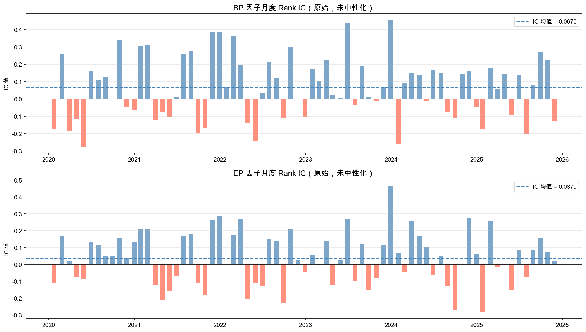
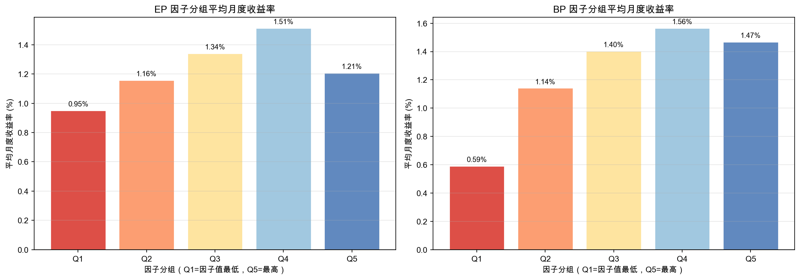
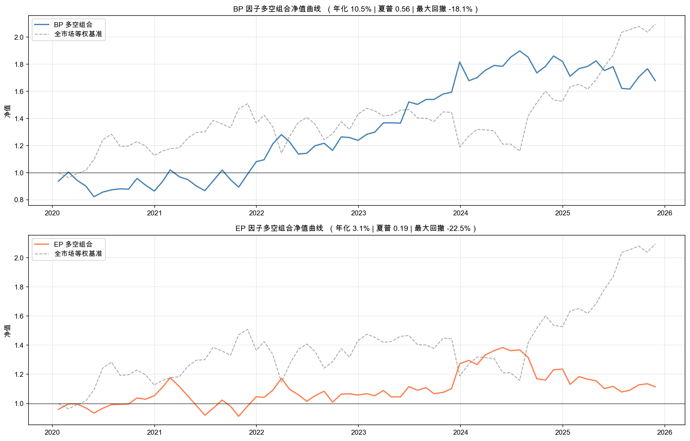

# A-Share Value Factor Research

Cross-sectional study of two classic value factors, **BP (book-to-price)** and
**EP (earnings-to-price)**, on the Chinese A-share market, January 2020 to November 2025.

This is an exploratory research project, not investment advice. Results are in-sample,
cover one market and five years, and should be read with the limitations below.

---

## Overview

The question: do cheaper stocks earn higher returns the following month, and does the
effect survive after removing industry and size exposure?

The pipeline, all in Python (pandas, numpy, matplotlib):

1. Pull month-end fundamentals, prices and adjustment factors from the Tushare Pro API.
2. Compute forward one-month returns from **adjusted** closing prices.
3. Clean the cross-section (loss-makers, missing industry, recent IPOs, outliers).
4. Build EP and BP, then neutralise them against industry and log market cap.
5. Evaluate with monthly Rank IC, ICIR, quintile sorts and long-short portfolios.
6. Test a more realistic long-only version with turnover-based transaction costs.

---

## Key Results

Adjusted prices, monthly rebalancing, 2020-01 to 2025-11 (about 71 monthly observations).

| Metric | BP raw | BP neutralised | EP raw | EP neutralised |
|---|---|---|---|---|
| Rank IC mean | 0.067 | 0.053 | 0.038 | 0.040 |
| Rank IC std | 0.182 | 0.093 | 0.155 | 0.083 |
| ICIR | 0.37 | 0.57 | 0.24 | 0.48 |
| IC > 0 (% of months) | 62.0% | 64.8% | 60.6% | 70.4% |
| Long-short return (p.a.) | 10.5% | 9.4% | 3.1% | 8.9% |
| Long-short volatility (p.a.) | 18.9% | 9.8% | 16.0% | 8.6% |
| Long-short Sharpe | 0.56 | 0.96 | 0.19 | 1.03 |
| Max drawdown | -18.1% | -10.2% | -22.5% | -12.5% |

Average monthly forward return by quintile (%), Q1 = lowest factor value, Q5 = highest:

| Factor | Q1 | Q2 | Q3 | Q4 | Q5 |
|---|---|---|---|---|---|
| BP neutralised | 0.80 | 1.06 | 1.23 | 1.49 | 1.58 |
| EP neutralised | 0.85 | 1.12 | 1.15 | 1.44 | 1.59 |
| BP raw | 0.59 | 1.14 | 1.40 | 1.56 | 1.47 |
| EP raw | 0.95 | 1.16 | 1.34 | 1.51 | 1.21 |

Long-only top quintile of neutralised BP (equal-weighted, assumed 0.3% round-trip cost,
average monthly turnover 10.5%):

| | Long-only Q5 (net) | Equal-weight universe | Excess (net) |
|---|---|---|---|
| Return (p.a.) | 18.6% | 14.8% | 3.8% |
| Volatility (p.a.) | 19.9% | 21.2% | 5.4% |
| Sharpe / information ratio | 0.93 | 0.70 | 0.71 |
| Max drawdown | -17.2% | -24.1% | -5.3% |

Before costs the long-only return is 19.0% and the excess 4.2%. The information ratio of
about 0.7 over roughly six years corresponds to a t-statistic near 1.7, before any
adjustment for the several variants tried.

Neutralised BP long-short return by calendar year (annualised from the monthly mean):
2020 -2.9%, 2021 17.4%, 2022 8.3%, 2023 26.9%, 2024 5.9%, 2025 0.0% (11 months).

### Figures

IC time series (raw, un-neutralised factors):


Average quintile returns (raw, un-neutralised factors):


Long-short net asset value (raw, un-neutralised factors):


---

## Key Findings

1. **Price basis matters a lot.** An earlier run used unadjusted closing prices, so stock
   splits and ex-dividend drops were counted as losses. On that basis the neutralised BP
   long-short looked like 14.7% p.a. with a Sharpe of 1.63, and EP looked ineffective
   (raw Sharpe -0.23). With adjusted prices, and returns computed only between consecutive
   month-ends, BP falls to 9.4% p.a. and a Sharpe of 0.96, while EP rises to a Sharpe of
   1.03 after neutralisation. All results above use adjusted prices.
2. **Neutralisation reduces risk without removing the signal.** After industry z-scoring and
   a log-market-cap regression, IC volatility roughly halves, ICIR rises (BP 0.37 to 0.57,
   EP 0.24 to 0.48) and drawdowns shrink. Raw BP is not monotonic across quintiles (Q4 above
   Q5); the neutralised version is.
3. **BP and EP are similar in strength once neutralised.** With about 70 monthly observations,
   the gap between them is not statistically meaningful.
4. **The excess return is modest and uneven.** The neutralised BP long-short return was
   negative in 2020, roughly flat in 2025, and concentrated in 2023. The long-only excess
   of about 3.8% p.a. has an information ratio near 0.7. None of this was tested out of sample.

---

## Methodology

**Data.** Tushare Pro: `stock_basic` (industry, listing date), `daily_basic` (close, PE TTM,
PB, total and circulating market cap) and `adj_factor`, sampled on the last trading day of
each month. The universe is the set of currently listed A-shares on SSE, SZSE and BSE.

**Returns.** Forward return = adjusted close(t+1) / adjusted close(t) - 1, where adjusted
close = close x `adj_factor`. The return is set to missing unless the next observation is
exactly the next month-end, so gaps are never turned into multi-month returns.

**Cleaning.** Drop rows with missing or non-positive PE TTM or PB (loss-making companies),
missing industry, or fewer than 180 days since listing. Winsorise PE and PB at the 1st and
99th percentiles within each month. About 5,300 stocks remain.

**Factors.** EP = 1 / PE TTM, BP = 1 / PB. Higher means cheaper.

**Neutralisation.** Within each month: (1) z-score the factor within each industry; (2) regress
that z-score on log total market cap by OLS and keep the residual.

**Evaluation.** Monthly Spearman Rank IC between the factor and next-month return; ICIR =
mean IC / standard deviation of IC. Stocks are sorted into five equal-count groups each
month and held equal-weighted. Long-short = Q5 minus Q1. Annual return = mean monthly return
x 12, volatility = monthly standard deviation x sqrt(12), Sharpe uses a zero risk-free rate,
maximum drawdown is taken from cumulative returns.

**Long-only test.** Hold the top quintile of neutralised BP. Monthly turnover = share of
current holdings not in the previous month's top quintile; cost = turnover x 0.3%. The
benchmark is the equal-weighted average of the same cleaned universe, not the CSI 300.

---

## How to Run

1. Install dependencies: `pip install tushare pandas numpy matplotlib`.
2. Create `token.txt` in the project folder containing your Tushare token (one line). It is
   git-ignored; never commit it. The account needs enough points for `daily_basic` and `adj_factor`.
3. Run `01_data_fetching.ipynb` (about 40 minutes because of API rate limits). It writes
   `data/stock_industry.csv`, `data/raw_monthly_data.csv` and `data/adj_factor.csv`. The last
   cell of that notebook fetches adjustment factors and must run after the data cells.
4. Run `02_factor_construction.ipynb`. It writes `data/factor_data.csv`.
5. Run `03_backtest.ipynb`. It writes the figures and `data/results_summary.csv`.

The large raw and intermediate CSV files are not committed.

---

## Limitations

- Five years, one market, no out-of-sample test. Several variants were tried (EP and BP, raw
  and neutralised, 1 and 3 month horizons, adjusted and unadjusted prices), so the
  significance of any single result should be discounted.
- Survivorship bias: only currently listed stocks are included, and delisted stocks are missing.
- PE and PB have not been checked for point-in-time correctness against announcement dates.
- Forward returns are not winsorised. Equal-weighted quintile means can be moved by a few
  extreme small-cap months (the largest single-month return is about +426%).
- Transaction costs are a flat 0.3% round-trip assumption. ST stocks, price limits, suspensions
  and liquidity are not modelled.
- The short leg is hard to implement in A-shares, so the long-only excess is the more realistic figure.
- Industry labels come from Tushare's `stock_basic.industry` field, not the CSRC classification.
- The equal-weighted benchmark excludes loss-making and recently listed stocks.

---

## Project Structure

```
Quant_Project/
├── 01_data_fetching.ipynb        # Tushare ingestion, industry labels, adjustment factors
├── 02_factor_construction.ipynb  # adjusted returns, cleaning, EP/BP, neutralisation
├── 03_backtest.ipynb             # IC, quintile sorts, long-short, long-only with costs
├── README.md
└── data/
    ├── stock_industry.csv        # industry and listing date
    ├── results_summary.csv       # IC and performance summary (4 factor variants)
    ├── ic_timeseries.png
    ├── quintile_returns.png
    └── nav_curves.png
```

---

## Tech Stack

Python, pandas, numpy, matplotlib, Tushare Pro API.

## Author

Liu Jingxin, BSc Economics and Finance, Queen Mary University of London.
Last updated November 2026.
